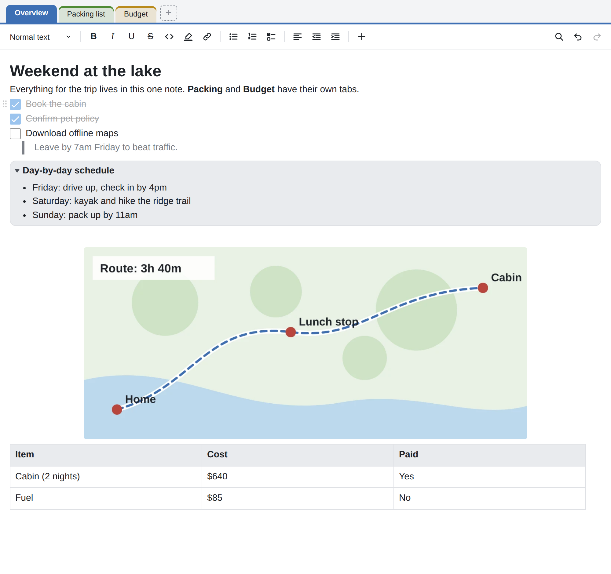
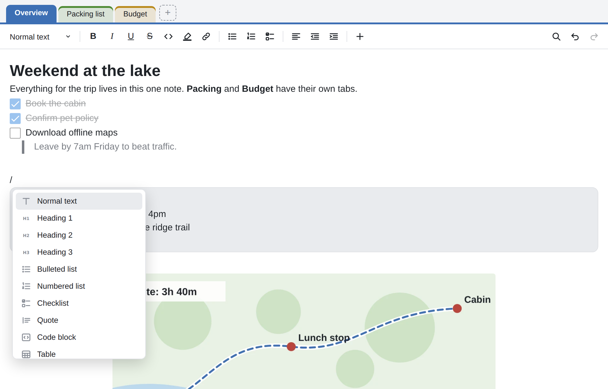
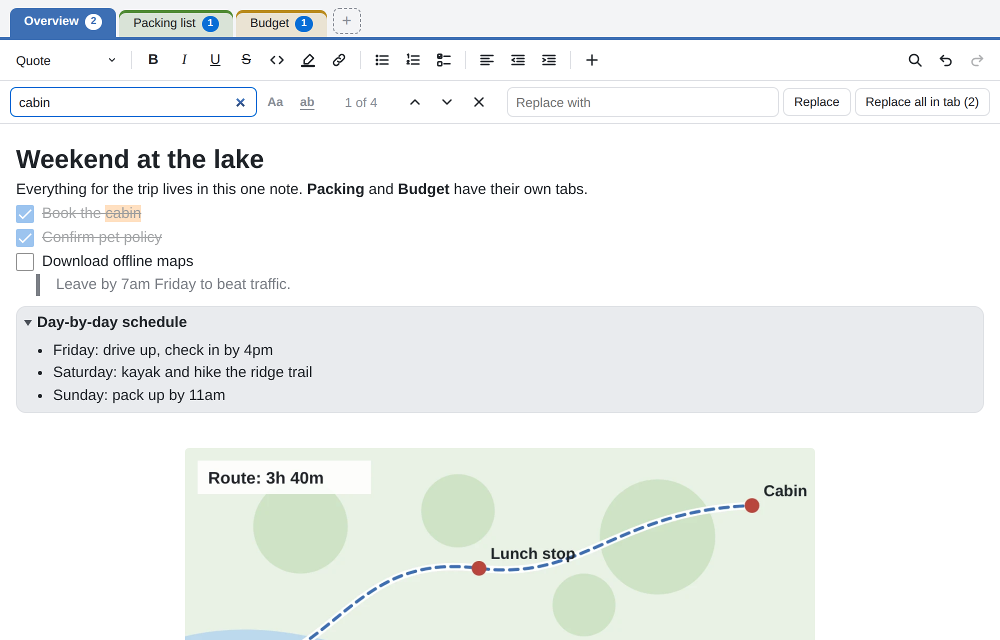
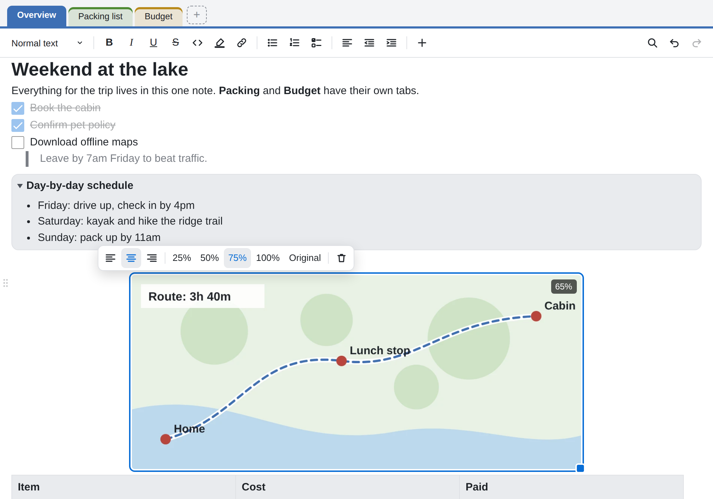

# Tabbed Notes for Standard Notes

OneNote-style tabs inside a single [Standard Notes](https://standardnotes.com) note. Each tab is its own rich-text page that looks and works like a Super note, with its own name and color.



## Features

**Tabs**
- Add as many tabs as you like to a single note
- Rename tabs, give each one a color, and drag them into any order
- Each tab keeps its own undo history
- Find across all tabs at once, with a match count on each tab

**Super-style editing on every tab**
- Type `/` for a block menu: headings, lists, checklists, quotes, code blocks, tables, collapsible sections, dividers, and images
- Markdown shortcuts as you type
- Drag handles to move blocks up and down
- Collapsible sections
- Tables with header rows
- Find and replace
- Paste screenshots and other images, then resize and align them
- Super's default font, text size, and line spacing
- Follows your Standard Notes theme, including dark themes

**Works with your existing notes**
- Open a Super note in Tabbed Notes and its content goes into the first tab, including checklists, tables, links, and collapsible sections
- Images Super uploaded to Standard Notes Files are kept linked (shown as placeholders, since plugins can't display them)
- Malformed Super content (the kind that can make a Super note open blank) is repaired rather than failing
- Plain text and Markdown notes are converted on the way in
- Nothing is saved until you make an edit

## Screenshots

| Type `/` for blocks | Find across all tabs |
| --- | --- |
|  |  |

| Resize and align images |
| --- |
|  |

## Compatibility

| Platform | Status |
| --- | --- |
| Web app (app.standardnotes.com) | ✅ Works once installed |
| Desktop app (Windows, macOS, Linux) | ✅ Works |
| Android app | ✅ Works (from plugin version 2.2.0) |
| iOS app | ⚠️ Not yet tested; expected to work the same as Android |

Tested with Standard Notes 3.202.9.

## Installation

> [!IMPORTANT]
> As of Standard Notes **3.202.9**, custom plugins can't be installed from the current apps. The web app blocks plugin downloads from most addresses, and fails with *"Error downloading package details"* even for allowed ones. The workaround below uses an older desktop app once, just to install the plugin. After that, the plugin works in current versions of every app.

### 1. Back up your notes

In Standard Notes, open **Preferences → Backups** and download a backup. Make sure your notes have finished syncing.

### 2. Install the older desktop app

Download and install Standard Notes desktop **3.191.4** from the [Standard Notes releases page](https://github.com/standardnotes/app/releases). Search the page for `desktop@3.191.4` to find it, and choose the installer for your system. Sign in to your account.

### 3. Install the plugin

In the older app, open **Preferences → Plugins**, choose **Install Custom Plugin**, and paste:

```
https://dandangerous.github.io/sn-tabbed-notes/ext.json
```

### 4. Update the desktop app

Update the desktop app to the latest version, or reinstall it from [standardnotes.com](https://standardnotes.com/download). Installed plugins are saved to your account, so Tabbed Notes stays installed and also appears in the web and mobile apps.

### 5. Start using it

Create a new note, open the note type menu, and choose **Tabbed Notes**.

## Usage

### Tabs

| Action | How |
| --- | --- |
| Add a tab | Click **+** next to the tabs |
| Rename a tab | Double-click it, or focus it and press `F2` |
| Change color, move, or delete | Right-click the tab (long-press on touch screens) |
| Reorder | Drag a tab left or right |
| Switch tabs from the keyboard | Focus a tab, then use `←` `→` `Home` `End` |

Deleting a tab that has content asks you to click a second time to confirm.

### Blocks and formatting

Type `/` anywhere to open the block menu. Keep typing to filter it, use `↑` `↓` to choose, and press `Enter`.

Hover over any block and drag the handle that appears on its left to move it. Drag handles aren't available on touch screens.

To add a collapsible section, type `/collapsible`. Click the arrow next to its title to open or close it. Press `Enter` in the title to move into the section. Press `Backspace` at the start of the title to turn it back into normal text.

Click inside a table to show the table button in the toolbar, for adding or deleting rows and columns.

### Images

Add an image by:

- **Pasting** a screenshot or copied image (`Ctrl/Cmd + V`)
- **Dragging** an image file onto the page
- Choosing **Image from device** from the **+** menu or the `/` menu (the best option on phones and tablets)
- Choosing **Image from URL** to show an image from a web address

Click an image to select it. A small toolbar appears for alignment (left, center, right), quick sizes (25%, 50%, 75%, 100%, or original size), and deleting. To resize freely, drag the blue handle at the image's corner. Sizes are a percentage of the page width, so images keep their proportions on every screen. Press `Backspace` or `Delete` to remove a selected image, or `Enter` to start a new line after it.

**How images are stored.** Plugins can't use Standard Notes Files, so pasted and uploaded images are embedded in the note itself, in the same format Super uses for embedded images. They're encrypted, synced, kept in backups, and available offline like the rest of the note. To keep notes manageable, images are automatically shrunk to at most 1600 pixels on their longest side and compressed, so a typical screenshot takes 100–400 KB. You'll see a warning for an unusually large image or when a note grows past about 5 MB, because very large notes save and sync slowly.

**Images uploaded in Super** (stored in Standard Notes Files) appear as a placeholder card. The link to the file is kept, so the image reappears if the note is opened in Super again.

### Find and replace

Press `Ctrl/Cmd + F` while in the editor, or click the magnifying glass in the toolbar.

- Search covers **every tab** in the note. Each tab shows how many matches it has, and stepping through matches with `Enter` and `Shift + Enter` moves between tabs.
- **Replace** and **Replace all in tab** only change the tab you're viewing, so you can always see what's changing. When the current match is in another tab, the status shows which one and Replace is unavailable until you're on that tab.
- Use **Aa** to match case and **ab** to match whole words only.
- A match inside a closed collapsible section opens that section.
- Replacements are normal edits: undo them with `Ctrl/Cmd + Z`. **Replace all in tab** undoes in a single step.
- Press `Esc` to close the search bar. The cursor is placed on the current match.

Searching never changes your note. Only replacing does.

### Markdown shortcuts

| Type | To get |
| --- | --- |
| `# ` to `###### ` | Headings 1 to 6 |
| `- ` or `* ` | Bulleted list |
| `1. ` | Numbered list |
| `[] ` or `[x] ` | Checklist |
| `> ` | Quote |
| ```` ``` ```` | Code block |
| `---` | Divider |
| `**bold**`, `*italic*`, `~~strike~~`, `` `code` ``, `==highlight==` | Inline formatting |

### Keyboard shortcuts

| Keys | Action |
| --- | --- |
| `Ctrl/Cmd + F` | Find and replace |
| `Enter` / `Shift + Enter` (in the search box) | Next / previous match |
| `Ctrl/Cmd + B`, `I`, `U` | Bold, italic, underline |
| `Tab` / `Shift + Tab` | Indent / outdent (in tables: next / previous cell) |
| `Ctrl/Cmd + Z` | Undo |
| `Ctrl/Cmd + Shift + Z` | Redo |
| `Ctrl/Cmd + click` | Open a link |

## How your data is stored

Tabs are saved as JSON in the note's text, so they sync, stay end-to-end encrypted, appear in note history, and are included in backups like any other note. Each tab's content uses the same format as Super.

If you switch a tabbed note to a different editor, you'll see the raw JSON. Your content is still there; switch back to Tabbed Notes to see the tabs again.

The editor makes no network requests of its own. It only loads images you insert from web addresses.

## Limitations

- **Images** are embedded in the note rather than uploaded to Standard Notes Files, which plugins can't access. Many large images make a note slow to save and sync, so it's worth keeping image-heavy pages in separate notes.
- **Images uploaded in Super** can't be displayed here; they appear as placeholders and are kept linked.
- **Pasting images on Android** depends on the keyboard. If pasting doesn't work, use **Image from device**.
- **Code blocks** don't color-highlight by programming language.
- **Find and replace** matches plain text, not formatting, and doesn't match across line breaks. If a replaced word was partly formatted (for example, half bold), the new text takes the formatting of the match's first letter.
- **`Ctrl/Cmd + F`** opens this editor's search while your cursor is in the note, instead of any Standard Notes or browser search on that shortcut.
- **Match highlighting** needs a recent browser or system WebView. On older ones, search still works, but matches aren't highlighted.
- **Text size and line spacing** follow Super's defaults. Plugins can't read the font size or line height you've set in Standard Notes preferences.

## Troubleshooting

**"Error downloading package details" when installing.** This is the Standard Notes issue described under [Installation](#installation). Use the older desktop app to install.

**The editor still looks like an older version.** GitHub Pages caches files for up to 10 minutes. Wait, then restart Standard Notes.

**An empty note with no tabs on Android.** Update to plugin version 2.2.0 or later.

## Building from source

The `source` folder contains the code. You need [Node.js](https://nodejs.org).

```bash
cd source
npm install
npm run build
```

This rewrites `index.html` in the repository root. Bump `version` in `ext.json` when you publish a change.

The editor is built on [Lexical](https://lexical.dev), the same editing engine Super uses, and talks to Standard Notes through [`@standardnotes/component-relay`](https://github.com/standardnotes/component-relay).

## Changelog

- **2.4.1** — Fixes typing and clicking right after selecting an image (text could land at the top of the page).
- **2.4.0** — Paste, drop, or upload images; resize and align them. Super's uploaded images are kept linked instead of being dropped.
- **2.3.0** — Find and replace: search across all tabs, replace in the current tab.
- **2.2.0** — Fixes the Android app showing an empty note with no tabs.
- **2.1.0** — Super's typography, drag handles for moving blocks, and collapsible sections.
- **2.0.0** — Super-style editing on each tab, built on Lexical. Opens Super notes and repairs malformed ones.
- **1.0.0** — First release: tabs with rich-text pages.

## License

[AGPL-3.0](LICENSE). This project bundles `@standardnotes/component-relay`, which is licensed under AGPL-3.0. Lexical is licensed under MIT.

Not affiliated with or endorsed by Standard Notes.
